<h1 align="center"></h1>

ChatGPT has the best multilingual speech-to-text models that I have tested, so pay their subscription if you want to use this tool (please OpenAI, don't sue me).

## Install

On macOS and Linux, run this command in a terminal. It installs Moulin and starts it. Run it again to update.

```sh
curl -fsSL https://brohoya.github.io/moulin/install.sh | sh
```

Or download Moulin for your computer: <a href="https://github.com/brohoya/moulin/releases/latest">Download</a>

Moulin is tested on macOS. The Windows and Linux versions are new.

## Use

1. Sign in to ChatGPT in the Moulin window.
2. Allow the microphone. On macOS, also allow Moulin in System Settings &gt; Privacy &amp; Security &gt; Accessibility, so that it can paste.
3. Push F5 and speak. Push F5 again: the text appears at the cursor, and it stays in the clipboard.

<p align="center"></p>

## Help

- If you want to make the  native dictation button F5 useful for the first time in history (because it opens the macOS dictation even after disabling it in settings):
  1. Install [Karabiner-Elements](https://karabiner-elements.pqrs.org)
  2. Add the Moulin rule, which changes this key into F13:

  ```sh
  brew install --cask karabiner-elements
  open "karabiner://karabiner/assets/complex_modifications/import?url=https%3A%2F%2Fbrohoya.github.io%2Fmoulin%2Fkarabiner.json"
  ```

  In Karabiner-Elements, click Import, then Enable. Congrats, now F5 is binded to F13, you lost the refresh button but you can use moulin :moyai:.
- Linux: the AppImage needs `libfuse2`. On Ubuntu 24.04, start it with `--no-sandbox`. To paste, install `xdotool` (X11), or `wtype` or `ydotool` (Wayland). On a GNOME desktop other than Ubuntu, install the "AppIndicator and KStatusNotifierItem Support" extension to see the windmill.

## Terms of Use and risk

- The OpenAI Terms of Use (Europe version, updated January 16, 2026) list under "What you cannot do": "Automatically or programmatically extracting data or Output". Moulin does this, so it breaks the terms, also for personal use.
- The terms also forbid "circumventing any rate limits or restrictions or bypassing any protective measures". Moulin bypasses nothing: each request comes from the real page, one request for each dictation, with a maximum of one automatic retry.

---

For developers: [docs/development.md](docs/development.md).